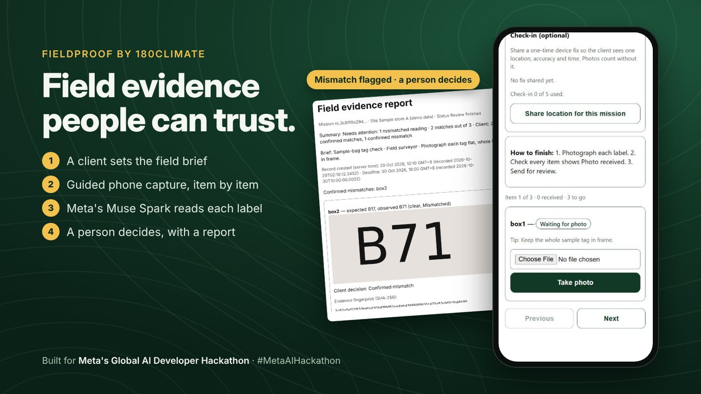
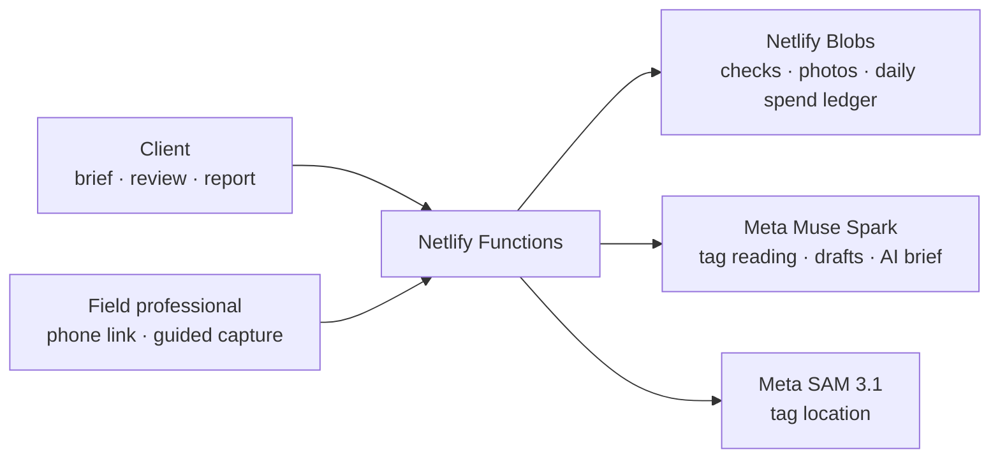

# FieldProof by 180Climate

### Field evidence people can trust.



> **AI can't walk into a forest.** FieldProof lets a client, or their AI agent, ask a person on the ground for evidence. Meta's Muse Spark reads it, and a person stays in charge.

**Live demo** and **3-minute video**: links added at release. · [Judge quick-start](#judge-quick-start) · [MIT licence](LICENSE)

FieldProof is a field assignment and evidence-review workflow. A client requests a field check. The field professional is guided item by item on their phone. **Meta's Muse Spark** reads each tag, FieldProof flags what needs a closer look, and **a person makes every decision**, with an evidence report and targeted follow-ups.

Built for **Meta's Global AI Developer Hackathon** (Startup track).

## Why it matters

In forests, mines and property due diligence, field work often ends with photos in a chat and paperwork that is hard to check. Which bag was photographed? What did the tag say? Who decided when it didn't match? FieldProof makes those answers part of the record.

It is the evidence layer of **180Climate's Fieldwork** direction: connecting the people who need answers from the ground with the professionals who can go and get them.

## How it works

1. **Client brief.** The client describes the check: site, items, deadline, and optional photo tips. They can type it, ask Muse Spark to draft it from a plain request, or draft it from a photo of a delivery note. A person confirms every field before anything is created.
2. **Guided capture.** The field professional opens a link (no install), gives consent, and is guided item by item ("Item 2 of 3"), with tips. They never see the expected codes or the comparison. An optional, consented location check-in records where the device was.
3. **AI reading.** Muse Spark reads each tag on the server and is instructed to answer "unclear" rather than guess. An unclear photo leads to a targeted close-up request (at most two, then the item is marked inconclusive). SAM 3.1 is asked to locate the tag on the stored photo; when it returns one, the client sees an "AI-located label" box. On our printed test tags it has not returned a box yet, so this step can be switched off (`SAM_MODE=off`).
4. **Review with suggestions.** The client sees a problems-first summary. A mismatch (B71 where B17 was expected) is flagged, never auto-corrected. FieldProof suggests what needs a closer look, and an on-request **AI brief** from Muse Spark sums up the open items. The client confirms each item.
5. **Evidence and follow-up.** A printable evidence report and a JSON evidence pack, plus a follow-up check for just the flagged items.

## Where Meta AI is used

| Model | What it does in FieldProof |
|---|---|
| `muse-spark-1.3`, vision with a strict JSON schema | Reads each tag on the server (`store: false`, no expected codes in the prompt); instructed to return "unclear" instead of guessing |
| `muse-spark-1.3`, function tool `create_field_mission` | Drafts a check from a plain request; a person confirms |
| `muse-spark-1.3`, vision extraction | Drafts a check from a delivery-note photo, quoting the source text for each field; unknowns are flagged |
| `muse-spark-1.3`, text with a strict JSON schema | The client's on-request AI brief, built from the item text only; cached per review state and capped per day |
| `sam-3.1` | Asked to locate the tag on the stored photo (switchable; no box returned yet on our printed test tags) |
| `muse-spark-1.3`, function calling (agent demo) | Plans and calls FieldProof's agent tools from a plain request; a person still decides every item |

## Designed to be trusted

- The field professional **never sees the expected codes** or the comparison results.
- **Unclear means unclear:** FieldProof asks for a close-up instead of guessing.
- **A person decides every item.** Mismatches are flagged, never auto-corrected, and AI suggestions never decide.
- **Spend-safe model calls:** each call reserves its maximum cost in a daily ledger before it runs, under a hard ceiling, and a storage retry never repeats a paid call.
- **Role-scoped links** for client and field professional: signed, expiring, and never carried in query strings. Creating a check in production needs an access code.
- **Honest fingerprints:** SHA-256 on the phone and the server shows the stored bytes are unchanged. It does not prove what the camera saw, and the report says so.
- **Location is optional and consented.** A check-in is the device's location at that moment, not the photo's location and not proof of attendance.

## Built to hold up in production

- **More than 300 automated tests** (`npm test`) and a strict TypeScript typecheck, including end-to-end runs of the real request handlers over mocked storage.
- **Fail-closed production mode.** With `FIELDPROOF_ENV=production`, a missing link secret or storage backend stops the request instead of falling back, test seams are refused, and creating a check needs the access code.
- **Health check.** `GET /.netlify/functions/health` reports `ready: true` only when every production setting is in place. It returns the version and yes/no flags, never a secret.
- **Safe to retry.** Repeating a create with the same `idempotencyKey` returns the same check. Every write is conditional, with a bounded retry, inside one storage scope per request.
- **Failures are visible.** If the AI brief can't be produced, the screen says so with a short reference code, and the review carries on.

## Judge quick-start

You need a phone (or a second screen) and about two minutes. The [judge kit](docs/judge-kit/) has synthetic tags and a sample delivery note.

1. Open the live demo → **Start a field check** → enter the access code from the submission notes.
2. Create a check for **B12, B17 and B23**: type it, or choose `docs/judge-kit/sample-delivery-note.png` → **Draft from delivery note**, pick a time zone, and confirm.
3. Open the field professional link on a phone. Photograph the judge-kit tags shown on another screen: **B12**, then **B71 for the B17 item** (a deliberate look-alike), then **B23**. Then **Send for review**.
4. Open the review link: see the flagged mismatch and the suggestion, ask for the AI brief, decide each item, then **Print report** or **Create follow-up**.

## Run it yourself

Prerequisites: Node 24 and npm.

```sh
npm --prefix app install
node app/scripts/gen-fixtures.mts   # synthetic test fixtures
node app/scripts/gen-images.mts     # synthetic label images (self-checking)
npm test                            # full automated test suite
npm --prefix app run build          # phone UI into app/dist
```

Deployment settings are in [docs/deploy-env.md](docs/deploy-env.md) (variable names only; secrets live in the Netlify UI, never in git). A deployed site answers `GET /.netlify/functions/health` with the app version and configuration booleans only.



Each request runs inside one storage scope over Netlify Blobs, with conditional writes and a bounded retry. With `READER=mock`, the full loop runs with no model calls.

## Use it from an AI agent

FieldProof ships a small **MCP server** with no dependencies, so an AI agent can request field checks on a client's behalf. It uses the same HTTP API under the same access code, and it stores nothing on disk.

| Tool | What the agent can do |
|---|---|
| `create_field_check` | Request a check, and get a field link for the field professional and a review link for the person who decides. Repeating the same request returns the same check |
| `get_field_check_status` | Follow a check it created: state, a problems-first summary, and each item's reading and decision |
| `get_evidence_pack` | Read the decisions and photo fingerprints once a person has finished the review |

There is no tool to capture photos or decide items: the field work and every decision stay with people.

Add it to any MCP client that runs local (stdio) servers, with Node 24:

```json
{
  "mcpServers": {
    "fieldproof": {
      "command": "node",
      "args": ["<path to this repo>/app/agent/fieldproof-mcp.mts"],
      "env": { "FIELDPROOF_URL": "https://<your FieldProof site>", "FIELDPROOF_ACCESS_CODE": "<access code>" }
    }
  }
}
```

**Meta's Muse Spark as the agent:** with `META_API_KEY` also set, `node app/agent/spark-agent.mts` starts a short chat in which Muse Spark calls the same three tools. Ask for a check in plain words, then ask for its status or evidence later in the same session. The script shows you the links directly, so Muse Spark never holds a link's access token. It makes at most 12 model calls per session.

## Jobs and bids (pilot, behind a switch)

"Hire a human" for field evidence, end to end. With `JOBS_ENABLED=on`:

1. **A client, or their AI agent, drafts a job:** outcome, broad region, dates, a **budget range**, and the items to evidence. An agent's job stays a draft until a person claims it with the access code and publishes it.
2. **The client invites professionals by private links,** one per person. Each professional sees the job (never the expected codes) and only their own bid.
3. **Professionals bid:** price, dates, method, exclusions and what they can do. Phone numbers, e-mails and links are kept out until a professional accepts.
4. **A person selects one bid, and the professional accepts.** Exactly one FieldProof check is created for that job, even if both click at once, and the professional gets the field link.
5. **The accepted engagement is recorded** (who, scope, value, date). There are no payments in the app; a success fee would be invoiced separately. The fee shown is an example, not yet live.

**For agents (MCP):** set `FIELDPROOF_JOBS=on` to add `post_field_job` (draft only) and `get_job_status` (counts and states only). For a job an agent drafts, the server issues only a read-only job link; the link that publishes, invites and selects is never sent to the agent or its MCP server. A person claims the job on the website with the access code, so an agent cannot publish, invite, choose or accept.

## Built during the Hackathon

FieldProof was built during Meta's Global AI Developer Hackathon. Hacking officially began on **26 Oct 2026 at 16:24 UTC**; the first commit in this repository is **27 Oct 2026, 03:12 UTC**, and the full history is preserved. Netlify's deploy records corroborate the timeline.

Existed before the event (and not in this repository): the 180Climate brand and its Fieldwork concept.

## What's next

- **Next:** AI agents requesting field checks across the 180Climate Fieldwork network.
- **Next:** WebMCP, so Meta AI can request a field check through the same three tools the MCP server offers today.
- **Future:** hands-free capture on display glasses.
- Pilot jobs in the 180Climate Fieldwork network.

## Honest limits

- A demo with synthetic tags. No pilot has run, and no real customer data has been collected.
- Photos and records are stored in Netlify Blobs in the US; regional hosting comes before any pilot.
- Model readings can be wrong. That is why a person decides every item.
- SAM 3.1 has not yet returned a label box on our printed test tags; the review then shows the photo without one.
- Link revocation is per server instance and does not survive a restart.
- The evidence pack is unsigned JSON.
- Through a generic MCP client, the agent sees the review link it passes on. There, keeping decisions with people is enforced by the tools offered, not by cryptography.
- FieldProof does not certify regulatory compliance.
- Jobs and bids is a pilot: synthetic jobs only so far, introduction terms are a pilot draft, and no fee is charged by the app. Claiming a job uses the site's one shared access code; per-client accounts come later. Private bid links work for anyone who holds them, so they are shared only with the invited professional.
