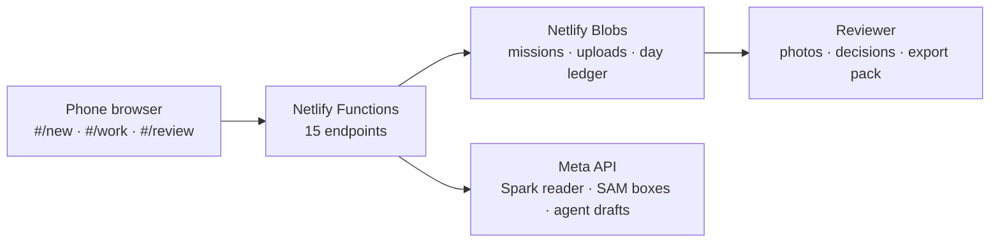

# FieldProof

FieldProof is a field-evidence product for a remote requester and an on-site worker. The requester opens a collection mission for labelled boxes; the worker photographs them on a phone; a server-side reader checks what is on each label; a reviewer confirms the outcome; and the mission exports a JSON evidence pack (mission record, readings, boxes, decisions).

Demo flow: one supplier collection, three labelled boxes (B12, B17, B23) against a synthetic delivery note. An unreadable label triggers a targeted close-up while the worker is still on site (at most two, then inconclusive). An expected B17 that reads as B71 becomes an evidence-linked discrepancy a human must review — the app never calls insufficient evidence a match.

Designed for 180Climate's fieldworks network.

## How Meta models are used

- **muse-spark-1.3** reads each captured label through the Responses API with a strict JSON schema (`readability`, `lot_code`), `store: false`, and no expected values in the prompt. Unknown content is instructed to return null rather than a guess — a reader instruction, not a guarantee.
- **sam-3.1** locates the label box on each stored photo (boxes only, best confidence, normalised 0–1). The reviewer sees it as an "AI-located label" rectangle when a box is present; otherwise the reviewer sees "none found" or an "unavailable" note with the per-item diagnostic.
- The **Spark function tool** `create_field_mission` drafts a mission from the requester's plain-English description (strict schema, forced tool choice). The agent only drafts: a human confirms and edits the fields before anything is created.
- Every model call reserves its maximum cost from a daily ledger first and settles once afterwards; timed-out or uncertain calls settle at the reserved maximum.

## Architecture



Each request runs its existing logic inside one per-request transact over Blobs (conditional writes with bounded retry); photo bytes travel outside the transact, bytes first. With `READER=mock` the label reader and the box are fixed stand-ins, so the full loop runs with no model calls.

## Integrity and safety

- SHA-256 on both sides: the browser hashes each photo, the server re-hashes every chunk and the assembled file. Hashes prove the bytes are unchanged, not that a photo shows the real box.
- Role links (requester, worker, reviewer) are HMAC-signed, expire, and are mission-scoped. Tokens travel in fragments, bodies, or headers — never in query strings. `#/new` additionally needs a requester access code in production.
- Revocation is currently process-scoped and does not survive a restart (persistence is deferred). Do not treat it as durable: an instance-local revocation may still allow a revoked link on another instance.
- A daily spend ceiling (US$2 demo default, `LEDGER_CEILING_USD` otherwise) fails closed, and production refuses to run without its secret, blob store, and access code.
- The worker's view is a capture brief: no expected labels, no reviewer decisions.

## Run it

Prerequisites: Node 24, npm.

```sh
node app/scripts/gen-fixtures.mts   # synthetic dev + held-out fixtures
node app/scripts/gen-images.mts     # synthetic label PNGs (self-verify PASS)
npm test            # full suite (node --test)
npm --prefix app run build   # phone UI into app/dist
```

Deploy settings live in [docs/deploy-env.md](docs/deploy-env.md) (variable names only — secrets go in the Netlify UI, never in git).

## Built during the Meta AI Developer Hackathon

Repo started 27 Oct 2026. Shipped so far: the mocked full mission loop (consent, capture, close-up, review, export); chunked uploads with server content hashes; versioned storage with conflict surfacing; the day-bounded model budget ledger; the phone UI with camera capture and reviewer screens; evidence photo serving; Spark reading, SAM boxes, and agent drafts behind mock-first flags; and the production requester access code.

## Honest limits

- This is a private demo, not a production release. No pilot has run; no real customer data has been collected.
- Photos and mission records are stored in US Blobs.
- Revocation is per-instance memory and does not survive a restart: a revoked link may still work on another instance.
- The evidence pack is unsigned JSON. Byte hashes prove the bytes are unchanged, not that a photo shows the real box.
- Live evidence so far (one phone mission): Create, three uploaded photos read by Spark as B12/B17/B23 matched, send for review, reviewer decisions, Finish, and JSON export all passed. SAM green boxes failed that pass (boxes absent, no diagnostics); the per-item S8 diagnostics are deployed but not yet live-verified — a follow-up smoke test did not get past mission creation, so no model calls ran. Blur/close-up, intentional mismatch, and agent drafts have not been evidenced live and are not claimed here.
