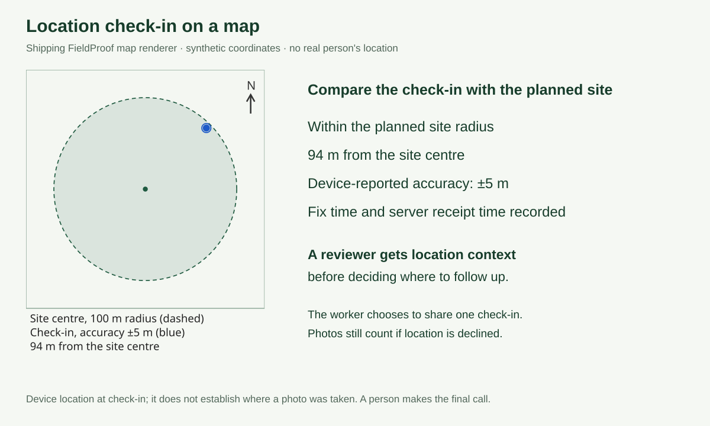

# FieldProof judge kit

Synthetic materials for trying FieldProof without real field samples. They show no real company, shipment or person.

| File | Use it for |
|---|---|
| `label-B12.png`, `label-B17.png`, `label-B23.png` | Tags that match the sample delivery note |
| `label-B71.png` | A deliberate look-alike. Photograph it for the **B17** item to see a flagged mismatch |
| `label-SB0412.png` | A field sample-bag tag, for a check of your own (enter `SB0412` as an item code) |
| `sample-delivery-note.png` | Choose it under **Draft from delivery note**. Muse Spark drafts the site, codes and deadline with the text it read. The note shows no time zone, so you pick one before creating |

## Sample agent run

[`sample-run/`](sample-run/) holds the output of one synthetic run on the live site: Muse Spark, as the client's agent, drafted a job; the website steps were carried out in the client, field-professional and reviewer roles; and the agent then fetched the evidence. No real customer, field professional, payment or location is involved.

| File | What it is |
|---|---|
| [`agent-transcript.md`](sample-run/agent-transcript.md) | The agent's two messages and replies, with the tools it called (the claim link and credential prompts are omitted) |
| [`evidence-report.pdf`](sample-run/evidence-report.pdf) | The printed evidence report: each photo, its decision and its SHA-256 fingerprint |
| [`evidence-pack.json`](sample-run/evidence-pack.json) | The unsigned JSON evidence pack for the same three decisions |

**How to use the tags:** show a tag on another screen (or print it) and photograph it from the field professional link. On a desktop browser, the photo button lets you choose the image file instead.

## Try the location check-in with synthetic coordinates

**What to look for:** the reviewer can compare the device check-in with a planned site, see the distance and accuracy, and spot a location that needs a follow-up. It is optional location context alongside the photos, not proof of their origin.

**[20-second synthetic UI example](location-check-in-20s.mp4):** actual shipping renderer/classifier output for a check-in about94m from the site and another about448m away. The clip is labelled synthetic and makes no geolocation request. Use the steps below to try the full live workflow yourself.

1. On the [live demo](https://fieldproof-180climate.netlify.app), choose **Start a field check** and use the access code supplied in the hackathon submission. Create the usual three-tag check. Set **Site latitude** to `-0.4996`, **Site longitude** to `101.4502` and **Site radius in metres** to `100`. Pick a valid deadline and time zone. These are synthetic example coordinates, not a tester's location.
2. Before sharing location from the worker view, open your browser's DevTools **Sensors** panel and choose a **Custom location**: latitude `-0.4990`, longitude `101.4508`. Chrome documents the [Sensors geolocation override](https://developer.chrome.com/docs/devtools/sensors#override-geolocation). This supplies a made-up device position instead of your real location. Complete any location-permission prompt yourself only after the override is set.
3. In the worker link, enter the normal consented collection flow and choose the actual button **Share location for this mission**. The browser reports the position, accuracy and time. The page acknowledges the check-in. Continue with the normal three photos and **Send for review**.
4. Open the client review. The diagram shows the **100 m planned-site radius**, the check-in point and its accuracy circle, and approximately **94 m from the site centre** for these example coordinates. The status uses the accuracy reported by your browser. The illustration below uses a simulated **5 m** accuracy; a less precise browser fix may be inconclusive or unverified instead.
5. If you choose **Show on OpenStreetMap**, the app discloses that the external provider receives those coordinates. Use synthetic data for this demonstration. The drawn site diagram works without loading map tiles. Turn off the Sensors override when finished.

**Optional failure-path check:** Sensors also offers **Location unavailable**. Sharing then saves no new fix and leaves the photo workflow available. Declining location also does not fail the photo check. No background position watching is used.

**How the reviewer benefits:** location context can flag an unexpected check-in before a person accepts the evidence or requests another visit. Accuracy and time remain visible so the reviewer can judge uncertainty. Device positions can be inaccurate or spoofed; a check-in does not establish where a photo was taken. The original sample agent run above has no location data and remains a separate example.
